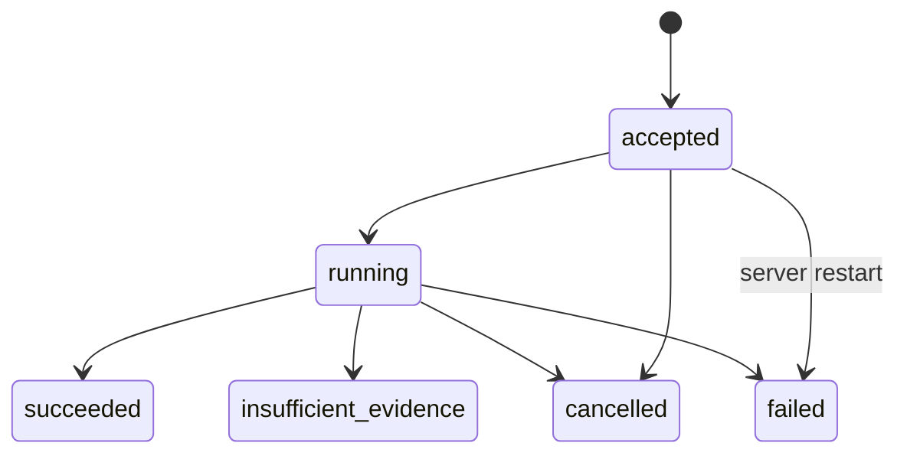

# TNT v2: implemented architecture and acceptance record

The original application was trying to make exoplanet exploration approachable: select a star, inspect it in a sky atlas, analyze astronomical evidence, and see candidate classifications with light-curve plots. Its central design defect was treating catalog knowledge, newly extracted transit signals and model predictions as interchangeable.

The fixed local result is an evidence workbench. It preserves the React/Flask/Aladin product and scientific libraries, while replacing the analysis boundary, hidden pipeline state, model loading, training path and workbench UI. The initial findings are retained in docs/INITIAL-AUDIT.md as a historical audit, not a description of the current implementation.

## First principles

1. Identity is mission + namespace + identifier. A TOI candidate number is not a TIC host ID, and a host may have many candidates.
2. Catalog measurements and independently extracted observations are distinct evidence sources. Neither a classifier score nor a BLS peak confirms a planet.
3. Missing, malformed and physically impossible measurements must not be turned into a numeric score. Signed lower uncertainty bounds are valid and must remain signed.
4. The model and its features are one contract: order, units, transformation, missingness policy, training labels and score semantics must agree at training and inference.
5. Results belong to immutable captured inputs. Late responses and cancelled work must never replace a different run's result.
6. A successful result must have enough provenance to identify its evidence, processing version and model, without depending on a mutable default filename.

## The abstraction that removes the coordination problem

An AnalysisRun owns a canonical target request, evidence mode, pinned model, evidence directory and durable state. UI components display that record rather than coordinating unrelated flags. Scientific stages operate on explicit inputs. A general workflow engine, microservices and event sourcing would add machinery without strengthening these invariants.

The server uses SQLite plus one bounded worker in one process. A file lock prevents two processes from owning the same data directory. There are at most 16 accepted/running jobs and uploads are bounded by the request size. A run URL survives a page reload. Restarted unfinished runs become explicitly failed, inviting a new submission rather than silently repeating expensive analysis.

Terminal states cannot regress. SQLite conditional updates prevent a late worker from publishing after cancellation. Cooperative stage checks prevent subsequent scientific stages. An already executing network request or numerical operation is allowed to finish; cancellation does not pretend to terminate native computation.

## Implemented contracts

- POST /runs captures mission, exact identifier, evidence source and model name. An optional Idempotency-Key reuses an identical request and rejects conflicting inputs. The UI retains the key when submission must be retried.
- GET /runs/:id returns the captured specification, status, stage, result or typed error. Internal filesystem paths are omitted.
- POST /runs/:id/cancel is idempotent and cannot change a completed result.
- GET /search validates all numerical ranges and filter ordering. It searches TIC; the UI no longer offers an ignored satellite selector.
- GET /models exposes the two supported baseline model contracts. Native offline candidates can also be selected by explicit model ID in the form.
- POST /train-model returns an explicit offline-only response. Inference cannot overwrite model files. Training runs through train.py.
- The legacy side-effecting GET /analyze, ambiguous prediction endpoint, pickle loading and duplicated API clients are removed.

Catalog resolution uses exact mission-aware parsing, resolves candidate aliases to one host, then retrieves every candidate for that host. An archive outage becomes upstream_unavailable; an empty catalog is insufficient evidence, not a negative classification. Catalog rows are snapshotted with a checksum. Catalog disposition stays separate from model output.

Light-curve acquisition saves inside its run directory. Download files remain owned by their run. A bounded, explicit in-memory observation index reuses successful listings between preview and acquisition; it does not cache failures. Upload filenames are ignored; every run owns its observation.fits. The API parses FITS before acceptance, and the pipeline checks the embedded TICID/KEPLERID against the selected host before extraction. Observation content is fingerprinted.

## Scientific pipeline corrections

The inherited source data contains engineered transit-probability values incompatible with the previous inference calculation; a complete source row observed during inspection had 1.294033 in training versus approximately 0.221943 from the physical adapter. Reusing those model files would preserve a training/inference defect even after fixing model loading.

Both baseline models were therefore rebuilt from the supplied source datasets. Training and live catalog analysis use the same adapter. Supplied engineered columns are discarded and recomputed from raw dependencies; missing dependencies stay missing. Feature schemas retain signed catalog uncertainties and declare units in contracts.py and the model manifests. Required measurements must be finite and pass basic physical-domain checks before any predictor is called.

The native XGBoost artifacts declare binary:logistic output, an explicit threshold and feature order. Model identities include both artifact and manifest fingerprints. A request pins those values; artifact mutation makes prediction fail rather than silently select another file. Missing model IDs never fall back. The imported custom-objective models and executable pickle artifacts are outside the active inference path.

Offline training partitions original hosts into training, validation and test sets before fitting. All candidates from one host stay in one partition. There is no oversampling. Early stopping uses validation data; test data is reserved for evaluation. An artifact and its manifest publish together by renaming a complete new directory. Ordinary training never replaces the baseline or a prior artifact.

The observation extractor was reduced from the original mutable pipeline to loading, quality filtering, normalization, bounded BLS search and plots. It uses a robust noise estimate and reports covered transits, fitted depth and depth uncertainty. It does not invent period, duration or epoch uncertainties. Because the catalog classifiers require features not established by this search, light-curve runs normally return exploratory measurements and plots with an unscored result. That is an honest supported outcome, not a substitute planet verdict.

Current observation bounds: 100 to 100,000 valid cadences, a baseline between 2 and 120 days, a search between 0.5 days and min(20 days, baseline/3), 4,000 tested periods and eight durations from 0.02 to 0.2 days. These bounds constrain work and explicitly limit this version's detection coverage. An exploratory flag requires at least three covered events and depth/depth_error >= 7; this heuristic is not a calibrated detection probability.

TOI labels use CP/KP versus FP and omit unresolved labels. KOI labels combine candidate/confirmed versus false positive. These are different training populations, so scores must not be compared across missions as if they were calibrated probabilities. Dataset and model evaluation fingerprints are in each baseline manifest. No claim of externally established scientific accuracy is made.

## State-machine disposition

| Original machine | Final handling |
| --- | --- |
| Analysis booleans and late responses | One persisted run status; current URL identity gates displayed results; polling cleanup aborts stale requests |
| Submission retries | Captured request plus idempotency key; conflicting key reuse rejected |
| Reload and process interruption | Saved run URL; unfinished work becomes failed on worker restart |
| Duplicate process ownership | Per-directory OS file lock; one worker owns transitions |
| Target selection | One mission/identifier form; changing mission clears the old identifier; TIC search explicitly selects a TESS host |
| Search | Explicit idle/loading/success/empty/error; controlled fields, server validation, abort on unmount |
| Mobile panel booleans | Removed; responsive document layout uses the same accessible forms |
| Sky viewer initialization | Disposable iframe owns SDK resources; latest numeric coordinates applied on readiness; failure independent of analysis |
| Catalog lookup and candidate choice | Alias-to-host resolution and all host candidates; no rows[0] classification shortcut |
| Download cache | Removed shared manifest; acquisition isolated per run with observation fingerprint |
| Upload reuse | Validated FITS content under a unique run directory; filenames cannot cause reuse |
| Scientific intermediate state | Explicit measurements and quality result; unavailable required features stay unscored |
| Feature conversion | One adapter/schema for training and catalog inference; legacy supplied engineered values discarded |
| Model selection | Native artifacts only, exact family/schema/units and checksums; no custom-name fallback |
| Training publication | Offline grouped training; complete immutable directory publication; no inference-path writes |
| Result transport | Typed failed/insufficient-evidence states; errors cannot normalize into a successful verdict |
| Candidate display | Every candidate shown, including partial missing evidence; catalog facts separated from model output |
| Training UI and disconnected controls | Removed; offline command and explicit model selection replace placeholder actions |

## The single day-one breaking test

Submit an analysis whose required feature keys exist but whose measurements are all null. Run it through the actual Flask API and worker pipeline with deterministic acquisition boundaries.

Acceptance: persisted terminal insufficient_evidence; no probability or verdict; zero calls to the native predictor; retained evidence snapshot; recoverable UI. This is now an integration regression. Related tests cover impossible finite sentinels, unknown models, changed artifacts, identifier confusion, conflicting idempotency keys, cancellation racing completion, process restart, all-candidate display, native model inference, grouped splits, offline artifact publication and synthetic transit extraction.

## Verification performed

- 19 Python unit/integration tests passed, including both real native baseline artifacts and a newly trained offline candidate.
- Two Node regressions passed for bounded scores and declared run states.
- Frontend ESLint and production build passed. Aladin is lazy loaded; its optional bundle still triggers Vite's size warning.
- Headless Chromium acceptance passed for submission, cancellation, multi-candidate rendering, reload recovery, mobile forms and an unavailable optional atlas. API data is deterministic in that test.
- Live NASA catalog analysis completed for KIC 11446443, returning a scored candidate. TIC 150428135 returned all four catalog candidates as insufficient evidence rather than manufactured scores.
- A pinned upstream TESS observation for TIC 139298196, sector 83, was replayed through real FITS loading, BLS search and plot generation. This proves processing executes; it does not establish that the detected signal is planetary.
- A live full-stack browser check is recorded in VERIFICATION.md with its exact outcome. It exercises browser -> Vite proxy -> Flask -> worker -> NASA catalog -> native model -> saved result.
- Both upstream reference checkouts remain unchanged. No changes were pushed and no remote repository was created.

## Limits and principal recommendation

This is a completed local workbench and a testable base for further product work. Keep the single-process modular design until real operating requirements demand another one. Prefer deleting misleading features over inventing evidence to keep them alive.

Independent scientific validation, calibrated scores, out-of-distribution detection, stronger transit vetting, broader observation coverage and user authentication for public hosting are separate work. The app binds to loopback by default; the supplied Compose configuration exposes only a loopback frontend. Run artifacts are retained intentionally and no automatic deletion is performed. Containers require a separate deployment check. The follow-up in VERIFICATION.md now verifies real sky tiles, pan/zoom, provider fallback and retry.

References for scientific units and APIs: [NASA TOI columns](https://exoplanetarchive.ipac.caltech.edu/docs/API_TOI_columns.html), [Astropy BLS](https://docs.astropy.org/en/stable/timeseries/bls.html). The TOI table reports transit depth in ppm; do not substitute the percent units of other archive tables merely because a column has the same name.

## Map target-selection implementation

The map is now a target picker. A settled camera position is reported from the isolated Aladin frame. Search this view performs one bounded TIC catalog request; the SDK projects returned coordinates and only includes stars actually on screen in the marker layer and accessible list. Broad views are gated and capped results are labelled. This avoids querying MAST continuously during a drag.

Marker clicks carry only an ID. The parent resolves it against the current discovered target set and captures a canonical TESS host in the existing form. Selecting a star checks the public supported light-curve index; unknown, available, none and failed checks have distinct UI outcomes. Availability does not assert scientific sufficiency. A visible target list provides a keyboard alternative to canvas interaction.

Moving the camera aborts and invalidates the old region request and clears its markers. Selection changes abort the prior availability request, with a short debounce to avoid issuing lookups during rapid clicks. Late responses cannot replace the current selection or repopulate an old view. The selected identity remains pinned when navigating elsewhere; markers are disabled during submission and analysis.

The live check found that Lightkurve can fall back to a slow name resolver after an exact lookup is empty. Availability and acquisition now share a bounded exact-ID MAST index query instead. Acquisition uses the returned public product URI, enforces size/read/time limits, and publishes a completed file atomically. Kepler observations stored as archive bundles expand through the product-list API rather than being mistaken for absent FITS data.

New endpoints: GET /sky/targets?ra=...&dec=...&radius=... (degrees), and GET /sky/targets/:tic/observations. The map is explicitly TESS/TIC in this version; manual Kepler analysis is retained. No extra dependencies were introduced.

## Evidence-first outcome contract

Run success now means usable evidence was returned, independently of classifier eligibility. Model status is an explicit scored/unscored field, and runtime scoring failure is nonfatal to already acquired measurements. The insufficient_evidence terminal state is reserved for runs that cannot provide useful measurements or catalog data, rather than being inferred solely from a missing model score.

Canonical TIC/KIC observation runs bypass candidate lookup and use metadata embedded in the actual FITS file. Candidate aliases still require identity resolution; catalog-mode runs still use the candidate catalog. This removes two optional network dependencies from basic observation processing.

Photometry export and its basic plot precede the exploratory transit search. CSV output retains all finite quality-filtered samples. Plot previews show at most 6,000 actual samples, with the sampling limit visible. Full measurements and original files are downloadable through fixed artifact routes scoped to each run. The API also exposes a bounded recent-run collection, without internal paths or large plot payloads.

UI changes replace the stacked form with a fixed workspace, keep the active target visible, distinguish connection errors from empty evidence and unavailable model scores, and make retry operate on the captured run inputs. This is a delivery and state-ownership repair, not a new scientific validation of the classifier.

## Combined target analysis

The workbench defaults to `combined`. It submits the captured mission, target and model in one durable run. Existing API defaults and saved single-source runs retain their meaning. Map selection fills the target and enables Analyze beside the map. The workbench no longer makes an extra observation request before submission.

For TIC/KIC, either source can succeed independently. TOI/KOI require catalog resolution before the pipeline has a host identifier. The worker checks cancellation at stage boundaries and classifies published rows using the pinned mission model. It validates each required measurement and records the names of invalid fields. Exploratory BLS measurements and catalog scores are displayed separately and remain separate even when their periods are similar.

| Scope | States and transitions |
| --- | --- |
| Browser submission | Idle ? submitting ? saved run or submission error. A retry of the same request reuses its idempotency key. |
| Browser cancellation | Active run ? cancelling ? return to selection on acknowledgement or an explicit cancellation error. |
| Saved run polling | A connection interruption retains the last record and offers reconnection. Responses from a different run are rejected. |
| Source outcome | Each requested branch returns ready, empty or failed. Empty means no usable evidence. Failure retains an actionable source message. |
| Combined terminal status | Any usable evidence yields success. No evidence and a failed source yields failure. No evidence and no failed sources yields insufficient evidence. |
| Model outcome | Scored, partially scored, unscored, unavailable, or no candidates. Candidate outcomes carry their own reasons. |

Combined results persist source states with evidence and provenance. Retrying a source failure starts a fresh run for the same captured target and keeps the original run in history. Cancellation prevents publication of the final result; an upstream call already in progress may run until its timeout.
